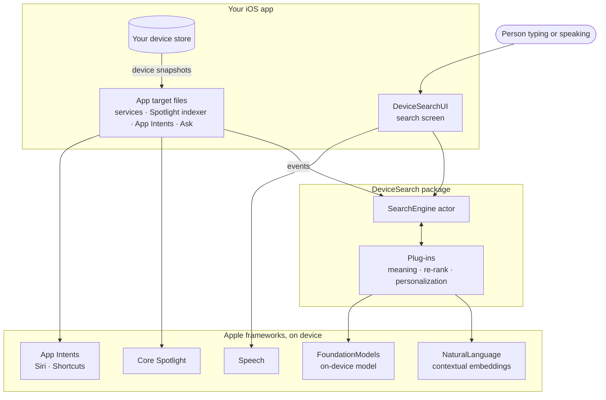
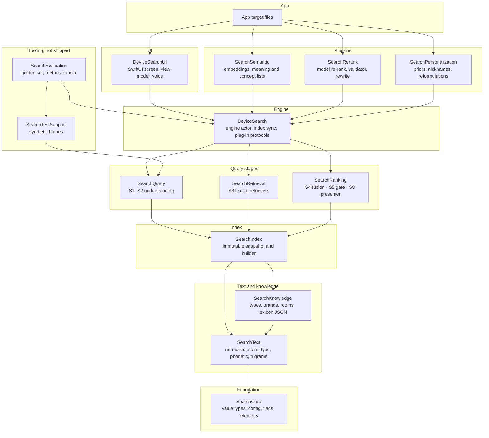
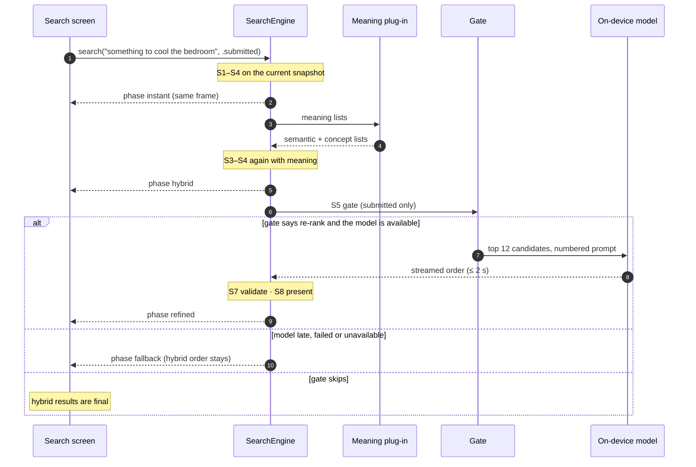
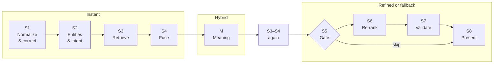
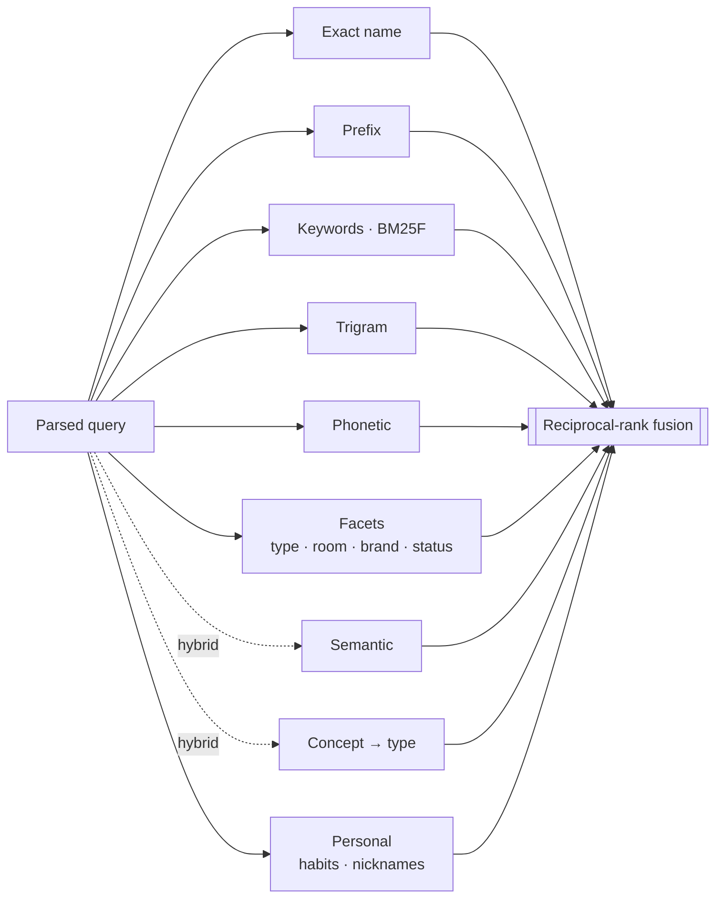
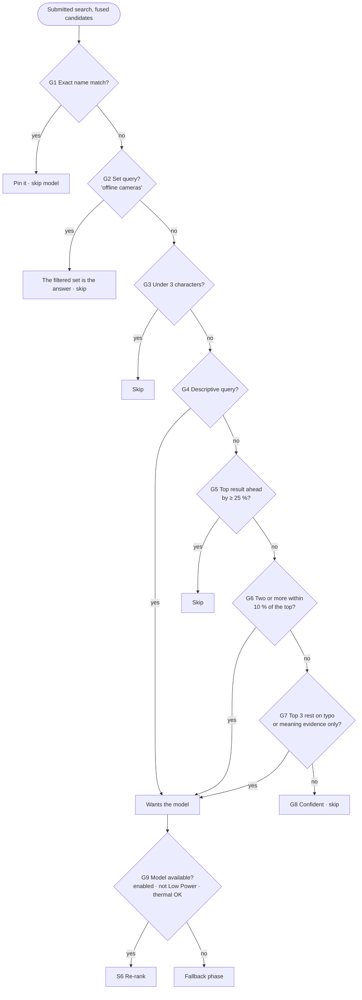
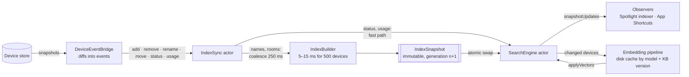
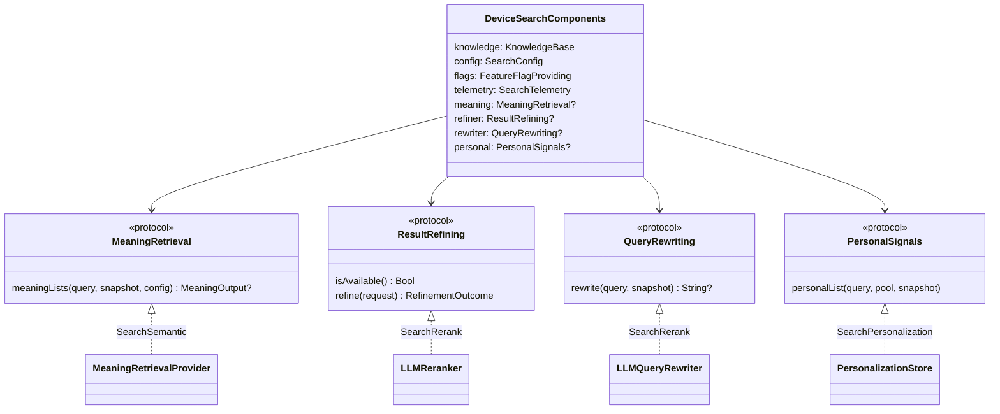
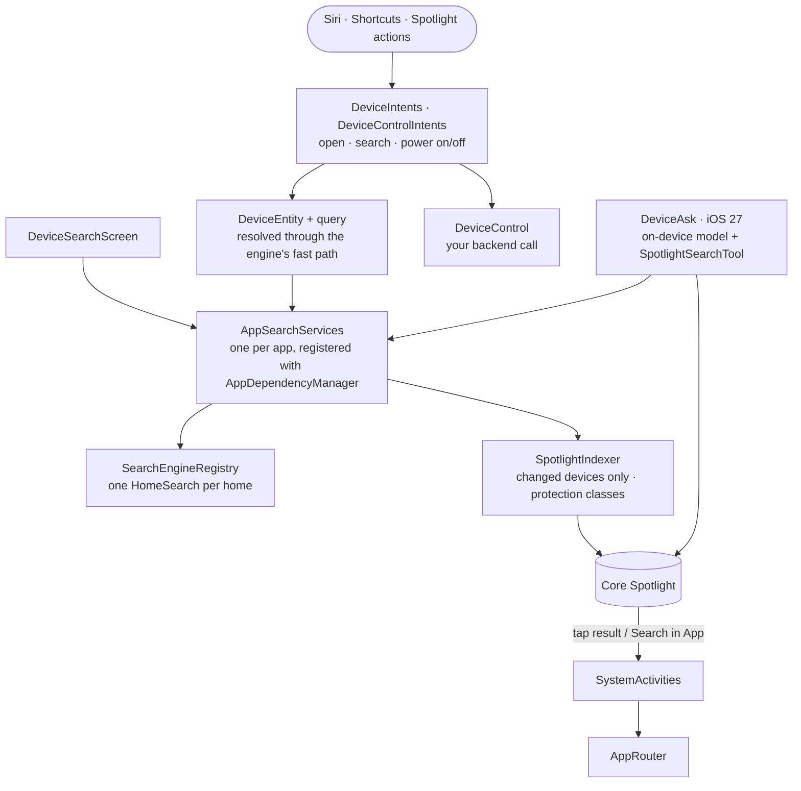

# Architecture

How DeviceSearch turns what someone types into a ranked list of their devices. The diagrams use [Mermaid](https://mermaid.js.org), which GitHub renders in place. For an interactive version with recorded query traces, open [docs/architecture.html](docs/architecture.html) in a browser.

Contents:
1. [System context](#1-system-context)
2. [Module layers](#2-module-layers)
3. [Three result phases](#3-three-result-phases)
4. [The pipeline, stage by stage](#4-the-pipeline-stage-by-stage)
5. [The re-rank gate](#5-the-re-rank-gate)
6. [The validator](#6-the-validator)
7. [Data plane: keeping the index current](#7-data-plane-keeping-the-index-current)
8. [Extension points](#8-extension-points)
9. [App integration](#9-app-integration)
10. [Concurrency model](#10-concurrency-model)
11. [Key numbers](#11-key-numbers)

---

## 1. System context

The package runs inside the app's process and uses only Apple frameworks. Nothing leaves the device.

## 2. Module layers

Fourteen Swift modules. Each layer depends only on the layers beneath it. The engine (`DeviceSearch`) knows nothing about embeddings or language models: those arrive as plug-ins behind protocols, so each one can be switched off or replaced.

Exact dependencies are in [DeviceSearch/Package.swift](DeviceSearch/Package.swift). Lower layers are also used directly where needed (for example, `SearchRanking` uses `SearchKnowledge`).

| Product | Link it when |
|---|---|
| `DeviceSearch` | Always: the engine and index sync |
| `DeviceSearchUI` | You want the ready-made SwiftUI search screen |
| `SearchSemantic` | You want descriptive searches ("something to cool the bedroom") |
| `SearchRerank` | You want the Apple Intelligence re-rank and query rewrite |
| `SearchPersonalization` | You want usage priors and learned nicknames |
| `SearchEvaluation` | Tests and benchmarks only |

## 3. Three result phases

Every query runs through up to three phases. Each phase replaces the results on screen as soon as it finishes, so the list is useful from the first keystroke and improves when the person submits.

| Phase | When | What changes |
|---|---|---|
| Instant | Same frame, every keystroke | Lexical retrievers plus personal signals, fused |
| Hybrid | After 120 ms idle while typing, or at once when submitted | Meaning lists join and fusion runs again |
| Refined | Submitted only, within 2 s | The model's order, checked by the validator |
| Fallback | The model was wanted but was late or unavailable | The hybrid order stays, and the UI says so |

Typing never calls the model. Only submitted searches reach the gate.

## 4. The pipeline, stage by stage

| Stage | Module | What it does |
|---|---|---|
| **S1** Normalize & correct | `SearchText`, `SearchQuery` | Lower-cases, folds accents, tokenizes. Fixes typos four ways: edit distance, phonetic keys, word splits ("livingroom"), suffixes. Weak corrections are kept as soft evidence only. |
| **S2** Entities & intent | `SearchQuery`, `SearchKnowledge` | Matches phrases (up to 4 words) against types, brands, rooms and synonyms, plus the home's own rooms and brands. Reads status ("offline", "on") and exclusions ("except kitchen"). Classifies intent: navigational, categorical, compound, descriptive or command. |
| **S3** Retrieve | `SearchRetrieval`, `SearchIndex`, `SearchPersonalization` | Six lexical retrievers read the snapshot (below). Personalization adds a list from usage, favourites and nicknames. In the hybrid phase, meaning adds semantic and concept lists. |
| **S4** Fuse | `SearchRanking` | Reciprocal-rank fusion (k = 20) merges every list. Boosts for covering every query word and matching named entities, plus a small usage prior. If nothing matches: raise typo tolerance once, then relax filters and say which. |
| **M** Meaning | `SearchSemantic` | Embeds the query with `NLContextualEmbedding` (or the bundled lexicon embedding). Semantic list: devices close in meaning. Concept routing: maps needs like "cool" to types (AC, fan) and boosts the named room. |
| **S5** Gate | `SearchRanking` | Decides whether the model is worth about a second (section 5). With no results at all, one model rewrite of the query may run first. |
| **S6** Re-rank | `SearchRerank` | Foundation Models orders the top 12 candidates from a compact numbered prompt. Streams: validated top rows lock in before the rest arrives. 2-second deadline. |
| **S7** Validate | `SearchRerank` | The model's answer is a suggestion; rules V1–V6 check it (section 6). |
| **S8** Present | `SearchRanking` | Builds sections (best matches, related, matching set), reason chips, highlights, the "Showing results for…" banner and any detected command. |

### Retrievers

Retrievers run in parallel; each returns its own ranked list, and fusion merges them.

## 5. The re-rank gate

The gate runs its rules in order; the first rule that decides wins.

## 6. The validator

The model never has the last word. Its numbered answer goes through six rules:

| Rule | Check |
|---|---|
| V1 Membership | Numbers outside 1…K are dropped |
| V2 Uniqueness | A number already placed is dropped |
| V3 Hard filters | A candidate that fails the query's filters (room, status, exclusions) is dropped |
| V4 Pinning | An exact name match goes first |
| V5 Omission recovery | A candidate matching every query word is kept even if the model left it out |
| V6 Blend and threshold | final = λ·model + (1 − λ)·fused (λ 0.65 descriptive, 0.45 otherwise); rows below 0.15 are hidden; if nothing qualifies, the top 5 fused candidates are shown |

## 7. Data plane: keeping the index current

Queries never wait for the index. Device changes build a new snapshot in the background and swap it in; a query in flight keeps the snapshot it started with.

An `IndexSnapshot` holds the documents, vocabulary, inverted index, name and fuzzy indexes, facet bitsets and vectors. A rebuild reuses cached vectors and only embeds devices whose searchable text changed (`DeviceRecord.contentHash`).

### Personal signals

- Usage prior = 0.7 × log(1 + uses) / log(1 + max uses) + 0.3 × favourite.
- A nickname is learned after the same device is picked three times for the same search.
- A reformulation (a new search within 5 s, with no tap in between) counts as a miss.

### Kill switches

`FeatureFlags` turn off meaning, re-rank, query rewrite, streaming re-rank, personalization, nicknames, Spotlight and voice independently. With everything off, instant lexical search still works.

## 8. Extension points

Plug-ins implement protocols declared in `DeviceSearch/ExtensionPoints.swift` and are passed in through `DeviceSearchComponents`. Every one is optional.

## 9. App integration

The files in `AppTarget/DeviceSearch/` connect the engine to the system. They live in the app target because App Intents and Spotlight need the app's own types.

- **Spotlight.** Each device is a `CSSearchableItem` whose title carries the room and name. Sensitive devices (locks, cameras) go to the `.complete` protection class. Only changed devices are re-indexed after a snapshot swap.
- **App Intents.** Open a device, search, and switch devices or a room's lights on or off. Locks, cameras, doorbells and garage doors are never switched. On iOS 27, Turn On / Turn Off Devices take several devices at once.
- **Ask (iOS 27).** Questions about the home, answered by the on-device model searching Spotlight. A proposal to replace `SpotlightSearchTool` with a tool backed by this engine is in [docs/device-search-tool-design.md](docs/device-search-tool-design.md).

## 10. Concurrency model

- `SearchEngine`, `IndexSync`, `SearchEngineRegistry` and the personalization store are **actors**. `IndexSnapshot` and every value type are immutable and `Sendable`.
- A search is an `AsyncStream<SearchSnapshot>`: one element per phase. Cancelling the consuming task cancels the remaining phases, including a model call.
- The model re-rank runs under a `Deadline`; missing it yields the fallback phase rather than an error.
- Swift 6 language mode with strict concurrency checking throughout.

## 11. Key numbers

All tunables live in `SearchConfig` ([SearchConfig.swift](DeviceSearch/Sources/SearchCore/SearchConfig.swift)); pass a modified copy to experiment.

| Parameter | Value |
|---|---|
| RRF k | 20 |
| Coverage / entity-match / prior boost | 0.12 / 0.10 / 0.04 (0.03 descriptive) |
| Candidates sent to the gate and model (K) | 12 |
| Prefix / keyword / trigram / phonetic limits | 40 / 60 / 30 / 30 |
| BM25 k1 | 1.2 |
| Trigram minimum Dice | 0.30 |
| Semantic minimum cosine | 0.35 |
| Concept minimum similarity / relative cut-off | 0.45 / 0.85 of best |
| Hybrid idle delay while typing | 120 ms |
| Gate: minimum characters / dominance / near-tie | 3 / 25 % / 10 % |
| Model deadline / max response tokens | 2 s / 64 |
| Blend λ descriptive / other | 0.65 / 0.45 |
| Hide below | 0.15 |
| Index rebuild coalescing | 250 ms |

### Measured quality

Golden set: 380 queries, 500-device sample home, seven categories.

| | Correct |
|---|---|
| DeviceSearch | 361 / 380 |
| Core Spotlight `CSUserQuery` | 65 / 380 |

Descriptive queries, nDCG@5: lexicon embedding 0.927, contextual embedding 0.437, lexical only 0.397.
