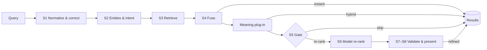

# DeviceSearch

**On-device search for smart-home apps.** It finds devices as people type, tolerates typos, understands rooms, types, status and exclusions ("lights except kitchen", "offline cameras"), and answers descriptive searches ("something to cool the bedroom") by meaning. When Apple Intelligence is available, a submitted search can be re-ranked by the on-device model, behind a gate and a validator, so the model never makes results worse.

Everything runs on the device. The package makes no network calls and depends only on Apple frameworks.

   

## Highlights

- **Instant results on every keystroke.** Six lexical retrievers (exact name, prefix, BM25 keywords, trigram, phonetic and facets) plus personal signals, fused with reciprocal-rank fusion in the same frame.
- **Typo tolerance.** Edit distance, phonetic keys, word splits ("livingroom") and suffixes. `bedrom ac` shows "Showing results for bedroom ac".
- **Query understanding.** Types, brands and rooms from a JSON knowledge base, plus the home's own rooms. Status ("offline", "on"), exclusions ("except kitchen"), counts and commands ("turn off all lights", always confirmed).
- **Meaning.** An embedding plug-in (`NLContextualEmbedding`, or a bundled lexicon embedding) and concept routing map needs like "cool" or "movie night" to device types.
- **Gated model re-rank.** Foundation Models orders the top 12 candidates only when the gate's rules say it will help, within a 2-second deadline. A deterministic validator checks every answer. Late or unavailable means the hybrid order stays.
- **Personalization.** Usage priors, favourites, and nicknames learned after the same device is picked three times for the same search.
- **Live index.** Device changes build a new immutable snapshot in the background (5–15 ms for 500 devices) and swap it in. Queries never wait.
- **System integration (app target).** Spotlight indexing with protection classes, App Intents and App Shortcuts for Siri and Shortcuts, and on iOS 27 an "Ask" screen that answers questions about the home with the on-device model.
- **Kill switches.** Every optional layer can be switched off; with everything off, instant search still works.

## How well it works

Measured with the evaluation suite: 380 labelled queries over a 500-device sample home, across navigational, typo, set, compound, number, descriptive and multilingual categories.

| Search | Queries answered correctly |
|---|---|
| DeviceSearch (this package) | **361 / 380** |
| Core Spotlight `CSUserQuery` over the same items | 65 / 380 |

Descriptive queries reach nDCG@5 0.927 with the lexicon embedding (0.397 with lexical retrieval only). Numbers come from a debug build on a Mac with the simulated re-ranker; see [docs/architecture.html](docs/architecture.html) for the recorded traces.

## Repository layout

```
DeviceSearch/          Swift package: the engine, plug-ins, SwiftUI screen, tests and evaluation
  Sources/             14 modules (see ArchitectureDiagram.md)
  Tests/               Swift Testing suites, one per module
AppTarget/DeviceSearch/  Files you copy into your app: services, Spotlight indexer, App Intents, Ask
DemoApp/               An iOS app that uses the package and AppTarget files with a fake device store
docs/                  Design documents and the interactive architecture page
```

## Requirements

| | Minimum |
|---|---|
| Package | iOS 26 / macOS 26, Xcode 26.4 or later, Swift 6 |
| Model re-rank and query rewrite | A device with Apple Intelligence turned on |
| Demo app's iOS 27 features (Ask, multi-device intents) | Xcode 27, iOS 27 |

## Getting started

### Try the package

```bash
cd DeviceSearch
swift build
swift test
```

### Run the demo app

Open `DemoApp/DeviceSearchDemo.xcodeproj` in Xcode, pick an iPhone simulator running iOS 26 or later, and run. Try `bedrom ac`, `lights except kitchen`, `something to cool the bedroom` or `turn off all lights`. [DemoApp/README.md](DemoApp/README.md) lists what each tab does and how to run the Spotlight self-test and comparison.

### Add it to your app

1. Clone this repository and add `DeviceSearch/` as a local package (File → Add Package Dependencies → Add Local). The manifest is in that folder, not at the repository root, so adding it by URL doesn't work yet. Link `DeviceSearch`, `DeviceSearchUI`, `SearchSemantic`, `SearchRerank` and `SearchPersonalization`.
2. Copy `AppTarget/DeviceSearch/` into your app target. Make your device model conform to `SearchableDevice` (`SearchableDevice.swift`), and replace the placeholders in `AppSetup.swift` with your device store and your backend's control call.
3. Add the Info.plist keys listed in [AppTarget/DeviceSearch/Info-plist-keys.md](AppTarget/DeviceSearch/Info-plist-keys.md).

Using the engine directly:

```swift
import SearchCore
import SearchKnowledge
import DeviceSearch

let components = DeviceSearchComponents(knowledge: try KnowledgeBase.bundled())
let home = await HomeSearch.make(homeID: "home-1", devices: [
    DeviceRecord(id: "d1", name: "Bedroom AC", manufacturer: "Samsung", type: "ac", room: "Bedroom",
                 status: DeviceStatus(isOnline: true, isOn: false)),
    DeviceRecord(id: "d2", name: "Ceiling Light", manufacturer: "Philips Hue", type: "light", room: "Kitchen"),
], components: components)

// Each phase (instant, hybrid, refined or fallback) replaces the previous one.
// Without plug-ins only the instant phase runs.
for await snapshot in home.engine.search("bedrom ac", mode: .submitted, options: .standard) {
    print(snapshot.phase, snapshot.results.map(\.device.name))
}
```

Pass `meaning`, `refiner`, `rewriter` and `personal` to `DeviceSearchComponents` to turn on the plug-ins; `AppSearchServices.swift` shows the full wiring. Feed later device changes to `home.sync` (or pass an event stream to `SearchEngineRegistry.open`) to keep the index current.

## Architecture

The engine is a layered Swift package. Each module depends only on the layers beneath it, and the engine knows nothing about embeddings or language models: those arrive as plug-ins behind protocols.



See [ArchitectureDiagram.md](ArchitectureDiagram.md) for module layers, the search pipeline, the gate, the data plane and the app integration, and open [docs/architecture.html](docs/architecture.html) in a browser for an interactive version with recorded query traces.

## Documentation

| Document | What's in it |
|---|---|
| [ArchitectureDiagram.md](ArchitectureDiagram.md) | Diagrams of every layer, with the key numbers |
| [docs/architecture.html](docs/architecture.html) | Interactive architecture page with live query traces |
| [docs/design/hybrid-device-search.html](docs/design/hybrid-device-search.html) | The solution design (the "design doc §" references in the code) |
| [docs/design/build-plan.html](docs/design/build-plan.html) | The phased build plan the code was written against |
| [docs/device-search-tool-design.md](docs/device-search-tool-design.md) | Proposal: a Foundation Models tool backed by this engine, and how it pairs with `SpotlightSearchTool` |
| [docs/spotlight-developer-guide.md](docs/spotlight-developer-guide.md) | Notes on Spotlight and Core Spotlight for smart-home apps |
| [DemoApp/README.md](DemoApp/README.md) | Running and testing the demo app |

## Status

The package and demo app build and the test suite passes. The iOS 27 features are written against the iOS 27 beta SDK and are best tested on a device: in the beta Simulator the on-device model can't generate. `DeviceSearchTool` is a design proposal and is not implemented yet.

## Contributing

Contributions are welcome. Read [CONTRIBUTING.md](CONTRIBUTING.md) first, and please follow the [Code of Conduct](CODE_OF_CONDUCT.md). Report security issues privately as described in [SECURITY.md](SECURITY.md).

## License

DeviceSearch is available under the [MIT License](LICENSE).
